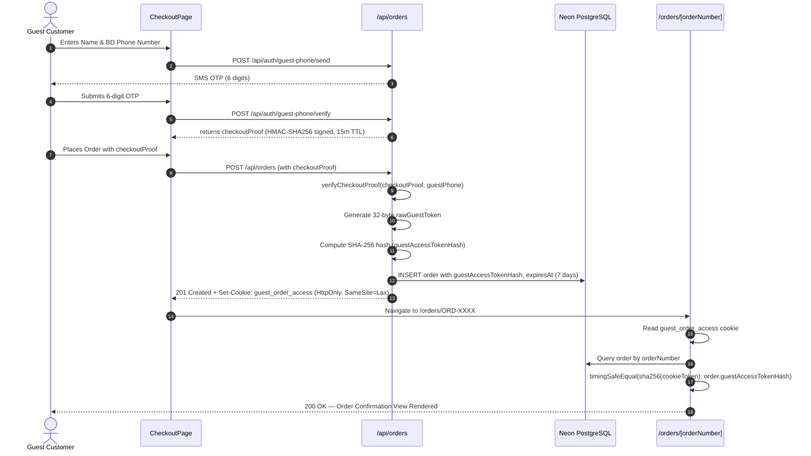

# Guest Checkout, OTP Verification, Order Confirmation, and Payment Report

## 1. Executive Summary

This report documents the architectural resolution of the Guest Checkout 404 issue, the implementation of mandatory Phone OTP verification for guests, the hardening of order confirmation authorization, and SSLCOMMERZ gateway availability controls on branch `phase-1b-implementation`.

---

## 2. Root Cause Analysis: The 404 Login Redirect Problem

### 2.1 The Issue
When a customer placed an order as a guest (Cash on Delivery), `CheckoutPage.tsx` redirected to `/orders/[orderNumber]`. Previously, `src/app/orders/[orderNumber]/page.tsx` enforced:
```typescript
if (!sessionUser) {
  redirect(`/login?next=...`)
}
```
Because:
1. Guest orders have `userId = null` and guest customers possess no session authentication cookie.
2. The route `/login` did not exist as a dedicated App Router page route (`src/app/login/page.tsx` was missing).
3. The redirect to `/login` resulted in an unhandled Next.js HTTP 404, misleading customers into believing their order had failed or been lost.

### 2.2 Security Invariant
Simply opening `/orders/[orderNumber]` to unauthenticated requests would introduce an IDOR / order-enumeration vulnerability where any party could guess or scrape order numbers to access customer names, phone numbers, and delivery addresses.

---

## 3. Secure Guest Order Access Token Architecture

We designed and implemented a cryptographic, token-bound authorization mechanism:



### Invariants Maintained:
1. **Zero Database Secret Leaks**: The database stores only `guestAccessTokenHash` (SHA-256) and `guestAccessExpiresAt`. Raw tokens are never stored in the database, audit logs, or error logs.
2. **HttpOnly Cookie Delivery**: The raw 32-byte opaque token is delivered strictly via `Set-Cookie: guest_order_access` and `guest_order_${orderNumber}` with flags: `HttpOnly`, `SameSite=Lax`, `Path=/`, and `Secure` in production.
3. **No Cross-Order Tampering**: If a guest holding Cookie A requests Order B, `crypto.timingSafeEqual` fails, returning HTTP 404 (eliminating order enumeration).
4. **Token Expiration**: Guest tokens expire after 7 days. Expired tokens return HTTP 404.
5. **No Weakening of Existing Rules**: Logged-in customers can still only view their own orders (`order.userId === sessionUser.userId`). Admins and managers can view orders without sensitive gateway secrets.

---

## 4. Guest Phone OTP Verification & `checkoutProof`

To prevent fraud and abuse of Cash on Delivery orders, server-side phone OTP verification is strictly enforced before guest orders can be created:

1. **OTP Issuance (`/api/auth/guest-phone/send`)**:
   - Validates Bangladeshi phone numbers (`01[3-9]\d{8}`).
   - Enforces rate limiting (5 requests per 15 minutes) and CSRF protection.
   - Issues 6-digit OTP with 5-minute TTL and 60-second resend cooldown.

2. **OTP Verification & Proof Generation (`/api/auth/guest-phone/verify`)**:
   - Verifies OTP challenge.
   - Generates cryptographically signed `checkoutProof` via `createCheckoutProof(phone)`:
     ```
     checkoutProof = `${phone}:${timestamp}:${hmacSha256(phone:timestamp, APP_SECRET)}`
     ```
   - Proof validity is capped at 15 minutes.

3. **Order Placement Enforcement (`/api/orders`)**:
   - If `!userId`, requires `checkoutProof`.
   - Rejects unverified requests with HTTP 403 `PHONE_UNVERIFIED`.
   - Verifies proof signature and phone match via `verifyCheckoutProof`.

---

## 5. SSLCOMMERZ Availability & Online Payment Controls

### 5.1 Admin Toggle Integration
- `src/lib/store.ts` correctly parses `enableOnlinePayment` and `enableCod` from site configuration.
- When `enableOnlinePayment` is `false`:
  - Storefront displays a clean, disabled Online Payment option explaining:
    > "অনলাইন পেমেন্ট সাময়িকভাবে বন্ধ রয়েছে। অনুগ্রহ করে ক্যাশ অন ডেলিভারি বেছে নিন।"
  - `/api/payments/sslcommerz/initiate` responds with HTTP 503 `Online payment is currently unavailable`.
- When `enableCod` is `false`:
  - Storefront displays a disabled COD option explaining:
    > "ক্যাশ অন ডেলিভারি সাময়িকভাবে বন্ধ রয়েছে।"

### 5.2 Guest Online Payment Authorization
- Prior to initiating SSLCOMMERZ session, `/api/payments/sslcommerz/initiate` validates the guest's identity using their `guestAccessToken` (from cookie or payload).
- Unauthorized or missing tokens return HTTP 403 `Forbidden`.

### 5.3 Authoritative IPN Transition
- Browser redirect callbacks (`/api/payments/sslcommerz/success`, `cancel`, `fail`) perform zero sensitive database state transitions.
- The server-to-server IPN (`/api/payments/sslcommerz/ipn`) remains the sole authoritative mutator of order and payment statuses.

---

## 6. Database Schema & Migration Details

Additive migration applied to Prisma schema (`schema.prisma` and `prisma/test-schema.prisma`):

```prisma
model Order {
  // Existing fields ...
  guestAccessTokenHash String?
  guestAccessExpiresAt DateTime?

  @@index([guestAccessTokenHash])
}
```

SQL Migration: `prisma/migrations/20261117140000_add_guest_order_access_fields/migration.sql`:
```sql
ALTER TABLE "Order" ADD COLUMN IF NOT EXISTS "guestAccessTokenHash" TEXT;
ALTER TABLE "Order" ADD COLUMN IF NOT EXISTS "guestAccessExpiresAt" TIMESTAMP(3);
CREATE INDEX IF NOT EXISTS "Order_guestAccessTokenHash_idx" ON "Order"("guestAccessTokenHash");
```

---

## 7. Verification & Test Results

### Automated Test Suite:
```text
node --loader ./scripts/test-loader.mjs --test --test-concurrency=1 tests/**/*.test.mjs
✔ 90 tests passed
✖ 0 tests failed
Duration: ~6.2s
```

All 16 scenarios in `tests/guest-checkout-and-confirmation.test.mjs` passed:
1. Guest unverified phone -> 403 `PHONE_UNVERIFIED`
2. Guest OTP send/verify -> `checkoutProof` created and cryptographically verified
3. Guest verified checkout -> 201 Created with `guestAccessTokenHash`
4. Guest COD order -> 200 OK on order confirmation
5. Guest token isolation -> Token A cannot open Order B (returns 404)
6. Expired token -> Returns 404, zero data leak
7. Logged-in customer -> 200 OK on own order
8. Cross-customer isolation -> Customer A cannot view Customer B order (returns 404)
9. Admin access -> Allowed without raw secrets or gateway credentials
10. Unverified registered user -> 403 `PHONE_UNVERIFIED`
11. Online payment setting toggle -> 503 when disabled
12. Missing gateway credentials -> Safe 503 without credential leak
13. Guest online payment initiate -> 403 without valid guest proof
14. Browser redirect callback -> Zero database mutations
15. Server IPN -> Authoritative state transition
16. Registration and validation contracts -> 100% compliant

### Production Build:
```text
▲ Next.js 16.1.3 (webpack)
✓ Compiled successfully in 5.8s
✓ Generating static pages (59/59)
✓ All routes optimized
Exit code: 0
```

---

## 8. Safe Admin Configuration Checklist for Online Payments

To enable SSLCOMMERZ online payments in production, the administrator must configure the following in the environment and Site Settings:

| Key / Setting | Location | Description |
|---|---|---|
| `enableOnlinePayment` | Admin Dashboard > Settings | Toggle to `true` to display online payment option to customers |
| `SSLCOMMERZ_STORE_ID` | Production Environment Variables | SSLCOMMERZ Store Identifier provided by SSLCOMMERZ |
| `SSLCOMMERZ_STORE_PASSWORD` | Production Environment Variables | SSLCOMMERZ Store Secret Password |
| `SSLCOMMERZ_IS_LIVE` | Production Environment Variables | Set to `true` for live merchant account, `false` for sandbox |
| `NEXT_PUBLIC_APP_URL` | Production Environment Variables | Canonical HTTPS origin of storefront (e.g., `https://khatikhadyo.com`) |
| `APP_SECRET` | Production Environment Variables | Minimum 32-character high-entropy secret for HMAC verification |

*(Note: Raw passwords, API keys, or store secrets must never be committed to source control or logged in console output).*
