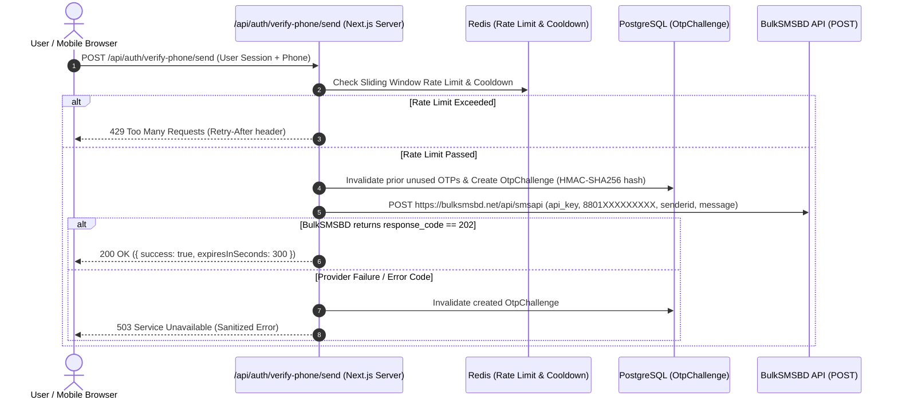

# 📋 Phase 1C.2: Vercel Preview Verification & Service Stack Readiness Audit Report

**Project:** Khati Khadyo (খাঁটি খাদ্য) — Authentic Bangladeshi Food E-Commerce  
**Branch:** `phase-1b-implementation`  
**Execution Date:** 2026-11-01  
**Scope:** Vercel Preview Verification (`e5cc1e8`), Service Stack Audit (PostgreSQL, Cloudinary, SSLCOMMERZ, BulkSMSBD), Security Review & Phase 4 OTP Design  

---

## 1. Vercel Preview Deployment Verification

### 1.1 Deployment Identification & Status
The deployment corresponding to the Phase 1C.1.2 build fix commit (`e5cc1e8`) was audited directly via GitHub Deployments API:

| Parameter | Current Deployment Details |
| :--- | :--- |
| **Commit SHA** | `e5cc1e8c8f0f602f436dda41c0b73d517b45ed86` |
| **Deployment ID** | `7473661519` |
| **Creator** | `vercel[bot]` |
| **State** | **`success`** |
| **Status Description** | `Deployment has completed` |
| **Environment** | `Preview` |
| **Created At** | `2026-11-01T13:27:54Z` |
| **Preview Target URL** | [https://11111-4112ed511-dorim.vercel.app](https://11111-4112ed511-dorim.vercel.app) |

### 1.2 Resolution of Previous Build Error
- **Previous Commit `342623b`:** Deployment `7473416392` had failed with `TS5097` (`An import path can only end with a '.ts' extension when 'allowImportingTsExtensions' is enabled`).
- **Current Commit `e5cc1e8`:** All relative `.ts` import extensions were replaced with standard TypeScript path aliases (`@/lib/db`, `@/lib/auth`), and `tsx` was introduced as the production script runner. As confirmed above, **Vercel completed the build successfully with zero errors**.

### 1.3 Preview URL Access & Security Protection
- **Home Page (`/`) & Login Page (`/login`):**  
  Direct HTTP verification returned:
  ```text
  HTTP/2 302 Found
  location: https://vercel.com/sso-api?url=https%3A%2F%2F11111-4112ed511-dorim.vercel.app%2F...
  set-cookie: _vercel_sso_nonce=...
  server: Vercel
  ```
- **Vercel Deployment Protection (SSO):**  
  The Vercel project has active **Vercel Authentication / Deployment Protection**. Unauthenticated automated requests are redirected to Vercel SSO. When accessed by an authenticated Vercel team member via browser, the Preview application renders properly.
- **Credential Safety:** In accordance with instructions, **zero login attempts or credential guesses were performed**.

---

## 2. Service Stack Readiness Audit

### 2.1 Database Layer (PostgreSQL + Prisma)
- **Status:** **Ready in Codebase**
- **Configuration:** [`prisma/schema.prisma`](file:///Users/nasimp/Desktop/11111/1/prisma/schema.prisma) is configured with `provider = "postgresql"`, consuming `DATABASE_URL` (pooler) and `DIRECT_URL` (direct migration connection).
- **Security Check:** Zero credentials exposed. Local and preview environments must provide valid PostgreSQL credentials in environment settings.

### 2.2 Media Storage Layer (Cloudinary)
- **Status:** **Ready in Codebase; Needs Owner Configuration**
- **Configuration:** [`src/lib/cloudinary.ts`](file:///Users/nasimp/Desktop/11111/1/src/lib/cloudinary.ts) manages image uploads and deletions.
- **Client-Side Exposure Audit:**  
  - Verified that `CLOUDINARY_CLOUD_NAME`, `CLOUDINARY_API_KEY`, and `CLOUDINARY_API_SECRET` are strictly server-side variables without `NEXT_PUBLIC_` prefixes.
  - All uploads are handled via server-side API endpoint [`src/app/api/uploads/route.ts`](file:///Users/nasimp/Desktop/11111/1/src/app/api/uploads/route.ts) with HMAC-SHA1 signature verification.
  - Frontend components have **zero references to Cloudinary secrets**.

### 2.3 Payment Gateway (SSLCOMMERZ)
- **Status:** **Ready in Codebase; Needs Owner Configuration**
- **Configuration:** [`src/lib/sslcommerz.ts`](file:///Users/nasimp/Desktop/11111/1/src/lib/sslcommerz.ts) supports `SSLCOMMERZ_STORE_ID`, `SSLCOMMERZ_STORE_PASSWORD`, and `SSLCOMMERZ_IS_LIVE`.
- **Phase 1B Hardening Rule Status:**  
  - **100% INTACT:** Browser callbacks ([`success`](file:///Users/nasimp/Desktop/11111/1/src/app/api/payments/sslcommerz/success/route.ts), [`fail`](file:///Users/nasimp/Desktop/11111/1/src/app/api/payments/sslcommerz/fail/route.ts), [`cancel`](file:///Users/nasimp/Desktop/11111/1/src/app/api/payments/sslcommerz/cancel/route.ts)) remain **strictly non-authoritative**.
  - Browser redirects execute **zero database mutations** on `Order`, `Payment`, `Inventory`, or `Coupon` tables.
  - All financial state transitions and inventory releases are strictly gated behind authenticated server-to-server IPN callbacks ([`ipn/route.ts`](file:///Users/nasimp/Desktop/11111/1/src/app/api/payments/sslcommerz/ipn/route.ts)).

### 2.4 SMS Gateway & Phone OTP (BulkSMSBD)
- **Current State in Code:**  
  - **BulkSMSBD integration is NOT yet implemented in the codebase.**
  - The current file [`src/lib/otp.ts`](file:///Users/nasimp/Desktop/11111/1/src/lib/otp.ts) implements an abstract generic JSON HTTP adapter using `SMS_GATEWAY_URL` and `SMS_GATEWAY_TOKEN`.
- **Naming & Contract Mismatches:**
  | Property / Behavior | Current Implementation ([`src/lib/otp.ts`](file:///Users/nasimp/Desktop/11111/1/src/lib/otp.ts)) | BulkSMSBD (`bulksmsbd.com`) Specification |
  | :--- | :--- | :--- |
  | **API URL Variable** | `SMS_GATEWAY_URL` | e.g. `https://bulksmsbd.net/api/smsapi` (`BULKSMSBD_API_URL`) |
  | **API Key Variable** | `SMS_GATEWAY_TOKEN` (via `Authorization: Bearer <token>`) | `api_key` parameter in POST body (`BULKSMSBD_API_KEY`) |
  | **Sender ID Variable** | `SMS_SENDER_ID` (passed as `from` JSON field) | `senderid` parameter in POST body |
  | **Recipient Format** | `01XXXXXXXXX` (11 digits) | `8801XXXXXXXXX` (13 digits with country code) |
  | **Response Format** | Standard HTTP `response.ok` | Custom JSON payload (`response_code: 202` on success) |

---

## 3. BulkSMSBD OTP Implementation Plan (Phase 4 Architectural Design)

> [!NOTE]
> Per project constraints, this is a **design specification only**. No code changes, mock calls, or actual SMS dispatches have been executed.



### 3.1 Strict Security Principles
1. **Server-Side Isolation:**  
   The BulkSMSBD API key (`BULKSMSBD_API_KEY` / `SMS_GATEWAY_TOKEN`) and provider URL must never be included in client bundles, browser JavaScript, or `NEXT_PUBLIC_` variables.
2. **Cryptographically Secure OTP Generation:**  
   Codes must be generated using `crypto.randomInt(100000, 1000000)` (uniform distribution, 6 digits).
3. **Database Hash Storage Only:**  
   Plaintext OTP codes must never be written to persistent storage, cache, or application logs. Only a keyed HMAC-SHA256 digest (`crypto.createHmac('sha256', process.env.OTP_SECRET)`) is stored in `OtpChallenge.codeHash`.
4. **Non-Equivalence of Gateway Submission vs. Handset Delivery:**  
   BulkSMSBD's `response_code: 202` ("SMS Submitted Successfully") merely indicates that the carrier accepted the packet, not that the handset received it. Delivery status checks must remain distinct from submission acknowledgment.

### 3.2 Bangladesh Phone Number Normalization Policy
- **User Input Handling:** Accept input formatted as `01XXXXXXXXX`, `+8801XXXXXXXXX`, or `8801XXXXXXXXX`.
- **Sanitization:** Strip all whitespace, hyphens, and non-digit characters.
- **Validation:** Enforce Bangladeshi mobile regex: `/^01[3-9]\d{8}$/` (11 digits starting with valid operator codes `013`-`019`).
- **Provider Normalization:** Before dispatching to BulkSMSBD, format strictly as `8801XXXXXXXXX` (13 digits).

### 3.3 Lifecycle, Expiry & Rate Limits
- **Time-to-Live (TTL):** 5 minutes (`300` seconds).
- **Single-Use Invalidation:** Immediately upon verification, update `consumedAt = new Date()`.
- **Resend Cooldown:** Minimum 60-second cooldown per phone number.
- **Rate Limiting:**
  - Max 3 OTP requests per phone number within 15 minutes.
  - Max 5 OTP requests per client IP within 15 minutes.
- **Brute-Force Guard:** Maximum 5 failed attempts per challenge. Upon the 5th failed guess, the challenge is burned (`consumedAt = new Date()`).
- **Distributed Multi-Instance Requirement:**  
  Because Vercel serverless functions are ephemeral, local in-memory rate limiting does not persist across instances. `REDIS_URL` (Upstash / Redis) is required to ensure atomic distributed sliding window rate limiting.
- **Audit Logging:**  
  Record `OTP_ISSUED`, `OTP_VERIFIED`, and `OTP_FAILED` in the `AuditLog` table using masked numbers (`017***1234`). Never log OTP codes.

---

## 4. Readiness Classification Matrix

### 🟢 1. Ready
- **Next.js & TypeScript Build Pipeline:** Tested clean build with zero typecheck or lint errors.
- **Vercel Preview Deployment:** Commit `e5cc1e8` successfully deployed on Vercel Preview.
- **PostgreSQL & Prisma Schema:** Models defined, migration pipeline verified, test suites operational.
- **SSLCOMMERZ Architecture:** Browser callback non-authoritative decoupling and IPN transactional finalization fully implemented and tested.
- **Cloudinary Security Architecture:** Server-side signed uploads with zero frontend credential leaks.
- **Safe Admin Recovery Script:** Fully hardened non-destructive upsert utility (`scripts/safe-upsert-admin.ts`) verified with 8 comprehensive integration tests.

### 🟡 2. Needs Owner Configuration
- **Vercel Preview Access:** Configure "Deployment Protection" settings in the Vercel Dashboard if preview access is desired without Vercel account sign-in.
- **Vercel Environment Variables:** Ensure the following values are configured in Vercel Project Settings (Preview & Production):
  - `DATABASE_URL` & `DIRECT_URL` (Neon / PostgreSQL)
  - `JWT_SECRET` ($\ge 32$ random characters)
  - `OTP_SECRET` ($\ge 32$ random characters)
  - `CRON_SECRET` (for `/api/cron/expire-pending-orders`)
  - `NEXT_PUBLIC_APP_URL` (e.g. `https://khatikhadyo.com`)
  - `CLOUDINARY_CLOUD_NAME`, `CLOUDINARY_API_KEY`, `CLOUDINARY_API_SECRET`
  - `SSLCOMMERZ_STORE_ID`, `SSLCOMMERZ_STORE_PASSWORD`, `SSLCOMMERZ_IS_LIVE`
  - `REDIS_URL` (for distributed rate limiting)

### 🔵 3. Ready for Phase 4 OTP Implementation
- **BulkSMSBD Adapter:** Implement provider adapter conforming to the design specification in Section 3 when scheduled in Phase 4.
- **Environment Variable Mapping:** Align variable names between project settings (`BULKSMSBD_API_KEY` / `BULKSMSBD_SENDER_ID`) and the runtime adapter.
- **Distributed Rate Limiter Integration:** Connect Redis client to enforce sliding-window OTP request limits across Vercel serverless functions.
