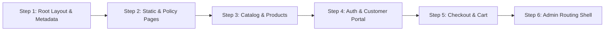

# 🗺️ Phase 2A: Next.js Route, SEO, Dependency & Migration Blueprint Audit

**Project:** Khati Khadyo (খাঁটি খাদ্য) — Authentic Bangladeshi Food E-Commerce  
**Branch:** `phase-1b-implementation`  
**Execution Date:** 2026-11-01  
**Author:** Antigravity AI Engineering Architecture Team  
**Scope:** Architecture Analysis, App Router Route Tree Design, SEO Blueprint, Dependency & Risk Matrix, UI/A11y Audit (Strictly Read-Only Analysis)  

---

## 1. Skills Actually Used

In compliance with project auditing rules, each skill evaluated during this audit is recorded below. Installed skills were applied directly to verify codebase contracts; skills not installed are designated as **Not Available**.

| Skill ID | Status | Purpose & Contribution | Files & Sections Audited |
| :--- | :---: | :--- | :--- |
| `nextjs-app-router-patterns` | **Active** | App Router directory architecture, Server/Client component boundaries, dynamic segments (`[slug]`), layouts, and streaming. | `src/app/page.tsx`, `src/app/layout.tsx`, `src/app/sitemap.ts` |
| `vercel-react-best-practices` | **Active** | Eliminating waterfalls, Server-Side Performance, `bundle-barrel-imports`, dynamic imports, caching (`server-cache-react`). | `src/components/pages/ProductDetailPage.tsx`, `src/components/pages/HomePage.tsx` |
| `vercel-composition-patterns` | **Active** | Component composition, compound layout patterns, decoupling monolithic page components into modular containers. | `src/components/layout/Navbar.tsx`, `src/components/layout/Footer.tsx` |
| `dependency-analysis` | **Active** | Dependency and regression risk mapping across Auth, Cart, Inventory, Payment, and SMS layers. | `src/lib/order-inventory.ts`, `src/lib/sslcommerz.ts`, `src/lib/otp.ts` |
| `backend-architect` | **Active** | Route migration blueprint, protected route boundaries, Next.js 16 proxy middleware integration. | `src/proxy.ts`, `src/app/api/auth/*`, `src/app/api/admin/*` |
| `database-architect` | **Active** | Database schema indexing, slug resolution queries, relational consistency across products and categories. | `prisma/schema.prisma`, `prisma/migrations` |
| `prisma-expert` | **Active** | Query optimization, relation loading (`include` vs `select`), unique constraint lookups for SEO slugs. | `src/app/api/products/[id]/route.ts`, `src/app/api/categories/route.ts` |
| `api-design-principles` | **Active** | RESTful route design, query parameter contracts, pagination standards. | `src/app/api/products/route.ts`, `src/app/sitemap.ts` |
| `api-security-best-practices` | **Active** | Protected route boundaries, CSRF validation, admin authorization enforcement. | `src/lib/security.ts`, `src/app/api/payments/sslcommerz/handler.ts` |
| `ui-a11y` | **Active** | Accessibility review: semantic `<Link>` vs `<button>`, ARIA attributes, keyboard navigation. | `src/components/layout/Footer.tsx`, `src/components/pages/HomePage.tsx` |
| `web-design-guidelines` | **Active** | UI clutter identification, visual hierarchy, professional placement of review and trust sections. | `src/components/pages/ProductDetailPage.tsx`, `src/components/layout/Footer.tsx` |
| `testing-patterns` | **Active** | Integration test strategy, route contract test blueprint, zero-regression guarantees. | `tests/sslcommerz-callbacks.test.mjs`, `tests/order-inventory-flow.test.mjs` |
| `api-contract-testing` | **Active** | API schema contracts between Next.js pages and backend endpoints during migration. | `src/app/api/policy-pages/*`, `src/app/api/reviews/*` |
| `writing-guidelines` | **Active** | Documentation structure, engineering precision, readability, and technical clarity. | Entire audit report |
| `architecture-patterns` / `senior-architect` | *Not Available* | Skill not present in environment; architecture performed via `backend-architect`. | N/A |
| `c4-context`, `c4-container`, `c4-component` | *Not Available* | Skill not present in environment; system modeling conducted via standard Mermaid diagrams. | N/A |
| `systematic-debugging` | *Not Available* | Skill not present in environment. | N/A |
| `clean-code` | *Not Available* | Skill not present in environment. | N/A |
| `code-review-excellence` | *Not Available* | Skill not present in environment. | N/A |

---

## 2. Current Architecture Map: SPA Simulation Analysis

### 2.1 The Root Monolith (`src/app/page.tsx`)
The current customer-facing application is implemented as a **Single Page Application (SPA) simulated inside a single Next.js App Router root page** ([`src/app/page.tsx`](file:///Users/nasimp/Desktop/11111/1/src/app/page.tsx)):
- The file is marked `'use client'`.
- Navigation is controlled entirely in-memory by Zustand state ([`src/lib/store.ts`](file:///Users/nasimp/Desktop/11111/1/src/lib/store.ts#L304)):
  ```typescript
  navigate: (page, params = {}) => {
    set({ currentPage: page, pageParams: params })
    if (typeof window !== 'undefined') window.scrollTo({ top: 0, behavior: 'smooth' })
  }
  ```
- A client-side `switch (currentPage)` statement renders over 20 distinct screens (Home, Products, ProductDetail, Cart, Checkout, Login, Register, Profile, Orders, OrderDetail, Policy pages, and all Admin tabs) under the exact same URL: `/`.

### 2.2 Critical Limitations of the Current SPA Simulation
1. **Zero Browser History & Broken Back/Forward Navigation:**  
   Clicking the browser's "Back" button does not return to the previous product or category; it navigates away from Khati Khadyo entirely.
2. **Unshareable Links:**  
   A customer viewing a specific product (e.g. *Sundarbans Mustard Honey 500g*) cannot copy the URL to share via WhatsApp or social media. The browser URL bar remains stuck at `https://khatikhadyo.com/`.
3. **Severe SEO Invisibility:**  
   Search engine crawlers (Googlebot, Bingbot) request individual URLs. Because the entire store is simulated inside `page.tsx`, crawlers only index the Homepage. Over 90% of the catalog, product descriptions, reviews, and categories cannot be crawled or indexed.
4. **Sitemap Contradiction:**  
   [`src/app/sitemap.ts`](file:///Users/nasimp/Desktop/11111/1/src/app/sitemap.ts) advertises URLs such as `/products`, `/contact`, `/delivery-policy`, and `/products?slug=...` to search engines. In reality, **none of these routes currently exist in `src/app/`**, resulting in `404 Not Found` responses when visited directly.
5. **Client Waterfall & Bundle Bloat:**  
   Even with dynamic imports (`lazy()`), initial hydration requires loading large client bundles, and all product details depend on client-side `fetch()` waterfalls rather than fast, cacheable server-side rendering.

---

## 3. Route Migration Blueprint (Proposed App Router Route Tree)

To transition from the SPA simulation to a modern Next.js 16 App Router architecture, the route hierarchy is structured below.

```mermaid
flowchart TD
    Root["src/app/layout.tsx (Root Layout & Global Providers)"] --> CustomerRoutes["Customer / Public Routes"]
    Root --> AuthGroup["(auth) Route Group"]
    Root --> CustGroup["(customer) Protected Group"]
    Root --> AdminGroup["(admin) Protected Shell"]
    Root --> APIRoutes["api/ (Backend Endpoints - Untouched)"]

    CustomerRoutes --> Home["/ (Homepage)"]
    CustomerRoutes --> Products["/products (Catalog Listing)"]
    CustomerRoutes --> ProductDetail["/products/[slug] (Product Detail)"]
    CustomerRoutes --> CategoryDetail["/categories/[slug] (Category Catalog)"]
    CustomerRoutes --> Cart["/cart (Shopping Cart)"]
    CustomerRoutes --> Checkout["/checkout (Secure Checkout)"]
    CustomerRoutes --> OrderConfirm["/order/[orderNumber] (Confirmation / Status)"]
    CustomerRoutes --> OrderTrack["/order-tracking (Public Tracking)"]
    CustomerRoutes --> Wishlist["/wishlist (Saved Products)"]
    CustomerRoutes --> Contact["/contact (Contact Us)"]
    CustomerRoutes --> Policies["/policy/[slug] (Terms, Privacy, Delivery, Return)"]

    AuthGroup --> Login["/login"]
    AuthGroup --> Register["/register"]
    AuthGroup --> ForgotPassword["/forgot-password"]

    CustGroup --> Account["/account (Profile Overview)"]
    CustGroup --> Orders["/orders (Order History)"]
    CustGroup --> OrderDetails["/orders/[id] (Customer Order Details)"]

    AdminGroup --> AdminDashboard["/admin/dashboard"]
    AdminGroup --> AdminProducts["/admin/products"]
    AdminGroup --> AdminCategories["/admin/categories"]
    AdminGroup --> AdminOrders["/admin/orders"]
    AdminGroup --> AdminPayments["/admin/payments"]
    AdminGroup --> AdminCustomers["/admin/customers"]
    AdminGroup --> AdminReviews["/admin/reviews"]
    AdminGroup --> AdminCoupons["/admin/coupons"]
    AdminGroup --> AdminSettings["/admin/settings"]
    AdminGroup --> AdminMedia["/admin/media"]
```



### 3.1 Proposed Directory Structure & Component Mapping

| Proposed Route | Route Type | Rendering Strategy | Source Component / Data Mapping |
| :--- | :--- | :--- | :--- |
| **`/`** | Public | **ISR (`revalidate = 3600`)** | [`src/components/pages/HomePage.tsx`](file:///Users/nasimp/Desktop/11111/1/src/components/pages/HomePage.tsx) |
| **`/products`** | Public | **Dynamic with SSR** | [`src/components/pages/ProductsPage.tsx`](file:///Users/nasimp/Desktop/11111/1/src/components/pages/ProductsPage.tsx) (Filter/Search params) |
| **`/products/[slug]`** | Public | **ISR (`revalidate = 3600`)** | [`src/components/pages/ProductDetailPage.tsx`](file:///Users/nasimp/Desktop/11111/1/src/components/pages/ProductDetailPage.tsx) (Fetched by `Product.slug`) |
| **`/categories/[slug]`** | Public | **ISR (`revalidate = 3600`)** | Category-filtered view of `ProductsPage` (Fetched by `Category.slug`) |
| **`/cart`** | Public | **Client Side** | [`src/components/pages/CartPage.tsx`](file:///Users/nasimp/Desktop/11111/1/src/components/pages/CartPage.tsx) (Synced with Zustand `cartItems`) |
| **`/checkout`** | Protected / Semi-Public | **Client Side (`force-dynamic`)** | [`src/components/pages/CheckoutPage.tsx`](file:///Users/nasimp/Desktop/11111/1/src/components/pages/CheckoutPage.tsx) |
| **`/login`** | Auth Public | **Client Side** | [`src/components/pages/LoginPage.tsx`](file:///Users/nasimp/Desktop/11111/1/src/components/pages/LoginPage.tsx) |
| **`/register`** | Auth Public | **Client Side** | [`src/components/pages/RegisterPage.tsx`](file:///Users/nasimp/Desktop/11111/1/src/components/pages/RegisterPage.tsx) |
| **`/forgot-password`** | Auth Public | **Client Side** | [`src/components/pages/ForgotPasswordPage.tsx`](file:///Users/nasimp/Desktop/11111/1/src/components/pages/ForgotPasswordPage.tsx) |
| **`/account`** | Protected (Customer) | **Dynamic Client / SSR** | [`src/components/pages/ProfilePage.tsx`](file:///Users/nasimp/Desktop/11111/1/src/components/pages/ProfilePage.tsx) |
| **`/orders`** | Protected (Customer) | **Dynamic Client / SSR** | [`src/components/pages/OrdersPage.tsx`](file:///Users/nasimp/Desktop/11111/1/src/components/pages/OrdersPage.tsx) |
| **`/orders/[id]`** | Protected (Customer) | **Dynamic Client / SSR** | [`src/components/pages/OrderDetailPage.tsx`](file:///Users/nasimp/Desktop/11111/1/src/components/pages/OrderDetailPage.tsx) |
| **`/order/[orderNumber]`** | Public / Confirmation | **Dynamic Client / SSR** | [`src/components/pages/OrderConfirmationPage.tsx`](file:///Users/nasimp/Desktop/11111/1/src/components/pages/OrderConfirmationPage.tsx) |
| **`/order-tracking`** | Public | **Client Side** | [`src/components/pages/OrderTrackingPage.tsx`](file:///Users/nasimp/Desktop/11111/1/src/components/pages/OrderTrackingPage.tsx) |
| **`/wishlist`** | Public | **Client Side** | [`src/components/pages/WishlistPage.tsx`](file:///Users/nasimp/Desktop/11111/1/src/components/pages/WishlistPage.tsx) |
| **`/contact`** | Public | **Static / ISR** | [`src/components/pages/ContactPage.tsx`](file:///Users/nasimp/Desktop/11111/1/src/components/pages/ContactPage.tsx) |
| **`/policy/[slug]`** | Public | **ISR (`revalidate = 86400`)** | [`src/components/pages/PolicyPage.tsx`](file:///Users/nasimp/Desktop/11111/1/src/components/pages/PolicyPage.tsx) (`delivery-policy`, `terms`, `privacy`, etc.) |
| **`/admin/*`** | Protected (Admin) | **Client Shell (`force-dynamic`)** | Dedicated layout guard (`src/app/admin/layout.tsx`) wrapping existing sub-tabs |

---

## 4. SEO & Discoverability Blueprint

### 4.1 Root Metadata & `metadataBase` Fix
- **Current Defect:**  
  During `npm run build`, Next.js logs:
  `⚠ metadataBase property in metadata export is not set for resolving social open graph or twitter images, using "http://localhost:3000".`
- **Root Cause:**  
  [`src/app/layout.tsx`](file:///Users/nasimp/Desktop/11111/1/src/app/layout.tsx#L8) exports `generateMetadata()` containing relative image URLs (`/all_logo.png`) without declaring `metadataBase`.
- **Implementation Blueprint:**  
  In `src/app/layout.tsx`:
  ```typescript
  const baseUrl = process.env.NEXT_PUBLIC_APP_URL || 'https://khatikhadyo.com'

  export const metadata: Metadata = {
    metadataBase: new URL(baseUrl),
    title: {
      default: 'Khati Khadyo - Authentic Bangladeshi Food Products',
      template: '%s | Khati Khadyo',
    },
    // ...
  }
  ```

### 4.2 Dynamic Product & Category Metadata
For each product detail page (`/products/[slug]`), Next.js Server Component will export `generateMetadata`:
```typescript
export async function generateMetadata({ params }: { params: { slug: string } }): Promise<Metadata> {
  const product = await getProductBySlug(params.slug)
  if (!product) return { title: 'Product Not Found' }

  return {
    title: `${product.name} | Khati Khadyo`,
    description: product.shortDescription || product.description?.slice(0, 160),
    openGraph: {
      title: product.name,
      description: product.shortDescription,
      images: [{ url: product.images[0]?.url || '/all_logo.png' }],
    },
    alternates: {
      canonical: `/products/${product.slug}`,
    },
  }
}
```

### 4.3 Structured Data (JSON-LD / Schema.org)
On `/products/[slug]`, inject rich Google snippet metadata:
```json
{
  "@context": "https://schema.org/",
  "@type": "Product",
  "name": "Sundarbans Raw Honey",
  "image": ["https://res.cloudinary.com/.../honey.jpg"],
  "description": "100% natural, unprocessed raw honey from the Sundarbans.",
  "sku": "KK-HNY-500",
  "brand": {
    "@type": "Brand",
    "name": "Khati Khadyo"
  },
  "offers": {
    "@type": "Offer",
    "url": "https://khatikhadyo.com/products/sundarbans-raw-honey",
    "priceCurrency": "BDT",
    "price": "650",
    "availability": "https://schema.org/InStock",
    "itemCondition": "https://schema.org/NewCondition"
  },
  "aggregateRating": {
    "@type": "AggregateRating",
    "ratingValue": "4.9",
    "reviewCount": "24"
  }
}
```

### 4.4 Sitemap & Robots.txt Standardization
- **`src/app/robots.ts`:**
  ```typescript
  export default function robots(): MetadataRoute.Robots {
    return {
      rules: [
        {
          userAgent: '*',
          allow: '/',
          disallow: ['/admin/', '/api/', '/checkout', '/account/', '/orders/'],
        },
      ],
      sitemap: 'https://khatikhadyo.com/sitemap.xml',
    }
  }
  ```
- **`src/app/sitemap.ts`:**  
  Update dynamic URL generator to produce canonical RESTful paths (`/products/${product.slug}` and `/categories/${category.slug}`) instead of query-string parameters.

### 4.5 Product Status & Canonical Policies
1. **Out of Stock Products:**  
   Retain status `200 OK`. Update schema availability to `OutOfStock`. Do not return 404 or redirect, as this degrades established Google search rankings.
2. **Deactivated / Permanently Deleted Products:**  
   Issue `404 Not Found` or `301 Moved Permanently` to the parent category page (`/categories/[categorySlug]`).
3. **Canonical Pagination:**  
   `/products?page=2` must specify canonical link pointing to `/products?page=2` (or self-referencing) to prevent duplicate content warnings.

---

## 5. Dependency & Risk Map

| System Domain | Route Migration Impact | Regression Risk | Required Safeguard & Test Coverage |
| :--- | :--- | :--- | :--- |
| **Payment Flow (Phase 1B)** | Browser callbacks redirect to `/` with query params (`?payment=success&orderId=...`). | If redirect destinations are broken during routing, customer does not see order confirmation. | **Acceptance Rule:** Maintain backward-compatible query param handler on `/` while supporting `/order/[orderNumber]`. Re-run all 25 automated tests to verify zero state mutation on callback. |
| **Authoritative IPN** | None (Runs strictly on `/api/payments/sslcommerz/ipn`). | Low (API routes remain untouched). | Ensure middleware and proxy routes never block POST requests to `/api/payments/*`. |
| **Cart & Wishlist** | Zustand store persists in `localStorage`. | Hydration mismatches between Server rendered HTML and client cart. | Wrap cart indicators with `isMounted` checks or dynamic client boundary. |
| **User Authentication** | `useAppStore` stores `accessToken` in memory / local storage. | Server Components cannot read in-memory client tokens. | Introduce secure httpOnly session cookies or maintain hybrid auth (Client components check Zustand, Server routes verify cookies/headers). |
| **Admin Protection** | Admin pages moved to `/admin/*`. | Unauthorized access if route layout lacks authorization guard. | Implement layout-level server redirect: non-admin requests redirected to `/login?next=/admin/...`. |
| **Prisma Query Performance** | Looking up products by slug on server pages. | Slow database lookups if slug is unindexed. | Verified: `Product.slug`, `Category.slug`, and `PolicyPage.slug` are marked `@unique` in `schema.prisma`. |
| **Cloudinary Media** | Image components render Cloudinary URLs. | Next.js `<Image>` hostname unconfigured. | Verified: `res.cloudinary.com` is configured in `next.config.ts` images domain whitelist. |

---

## 6. UI & Accessibility (A11y) Inventory

### 6.1 Unnecessary Clutter & Dead Elements
1. **Footer Fake Map Placeholder:**  
   In [`src/components/layout/Footer.tsx`](file:///Users/nasimp/Desktop/11111/1/src/components/layout/Footer.tsx#L398-L415), an empty decorative box titled *"View on Map"* has no interactivity, coordinates, or Google Maps link. **Recommendation:** Remove or replace with a real Google Maps link to the physical store/office.
2. **Triple Trust Badge Duplication:**  
   Trust badges (100% Authentic, Free Delivery, 7-Day Return, SSL Payment) are rendered in three separate places:
   - Footer ([`Footer.tsx:150-184`](file:///Users/nasimp/Desktop/11111/1/src/components/layout/Footer.tsx#L150-L184))
   - Homepage ([`HomePage.tsx:1056-1140`](file:///Users/nasimp/Desktop/11111/1/src/components/pages/HomePage.tsx#L1056-L1140))
   - Product Details ([`ProductDetailPage.tsx:1963-2011`](file:///Users/nasimp/Desktop/11111/1/src/components/pages/ProductDetailPage.tsx#L1963-L2011))  
   **Recommendation:** Keep high-impact trust badges on Product Detail (under CTA) and Homepage; simplify Footer to reduce visual noise.
3. **Hardcoded Mock Reviews on Homepage:**  
   [`HomePage.tsx:1222-1246`](file:///Users/nasimp/Desktop/11111/1/src/components/pages/HomePage.tsx#L1222-L1246) hardcodes static customer reviews.  
   **Recommendation:** Connect to real database reviews via `db.review.findMany({ where: { isApproved: true, rating: 5 } })`.

### 6.2 Customer Reviews Section Rules
- **Keep the Review Section:** Customer reviews are essential for social proof and conversion.
- **Placement Rules:**
  - On **Product Detail Page**: Position immediately below the primary product fold in a dedicated tab or section with aggregate rating score, star breakdown progress bars, and verified buyer tags.
  - On **Homepage**: Display a curated carousel of verified 5-star customer reviews with date and verified purchase badge.
- **Content Policy:** Only display reviews with `isApproved: true` from the database. Block unauthenticated spam submissions.

### 6.3 Accessibility (A11y) Improvements
1. **Semantic Navigation:**  
   Currently, Footer and Navbar navigation links use `<button onClick={() => navigate(...)}>` instead of `<Link href="...">`. This makes navigation invisible to screen readers, tab indexing, and search engine spiders. **Mandatory Fix:** Replace all navigation buttons with standard `<Link>` components.
2. **Missing Form Labels:**  
   Review submission forms and quantity steppers require explicit `aria-label` or `<Label>` associations.
3. **Focus States:**  
   Add visible keyboard focus rings (`focus-visible:ring-2 focus-visible:ring-primary`) on all interactive buttons and inputs.

---

## 7. Migration Phasing & Rollback Strategy

To ensure zero downtime and prevent accidental disruption of live order processing, migration will occur in progressive stages during Phase 2B:



1. **Step 1 — Root Shell & Metadata:** Configure `metadataBase`, global fonts, and robots/sitemap foundation in `layout.tsx`.
2. **Step 2 — Policy & Informational Routes:** Create `/contact` and `/policy/[slug]` (`terms`, `privacy`, `delivery-policy`, `return-policy`).
3. **Step 3 — Public Product Catalog:** Create `/products`, `/products/[slug]`, and `/categories/[slug]` with dynamic metadata and JSON-LD.
4. **Step 4 — Authentication Pages:** Create standalone `/login`, `/register`, and `/forgot-password` routes.
5. **Step 5 — Shopping Cart & Checkout:** Migrate `/cart`, `/checkout`, `/order/[orderNumber]`, maintaining full Phase 1B payment compatibility.
6. **Step 6 — Protected Customer & Admin Shells:** Create `/account`, `/orders`, and `/admin/*` protected layouts.

### Rollback Strategy
- **Fallback Root Retention:** The existing `src/app/page.tsx` SPA router will remain active as a fallback during the migration of independent routes.
- **Zero-Disruption API Policy:** No API routes or database schemas will be renamed or modified during route migration.

---

## 8. Phase 2B Implementation-Ready Acceptance Criteria

- [ ] Every public route (`/`, `/products`, `/products/[slug]`, `/categories/[slug]`, `/policy/[slug]`) is directly accessible via URL bar with valid HTTP `200` status.
- [ ] Browser Back and Forward buttons navigate between screens correctly.
- [ ] `npm run build` generates zero `metadataBase` warnings.
- [ ] `sitemap.xml` generates 100% crawlable, valid canonical URLs that match actual App Router routes.
- [ ] Phase 1B payment behavior remains 100% authoritative in IPN and non-authoritative in browser callbacks.
- [ ] All 25 automated integration tests continue to pass with 0 failures.
- [ ] All navigation links in Header and Footer use semantic Next.js `<Link>` elements.
