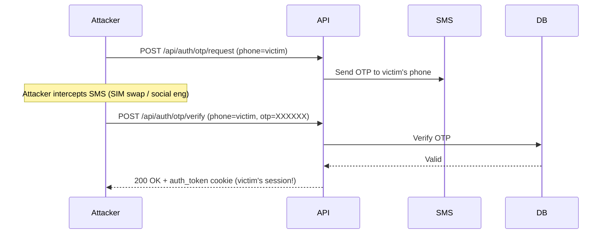
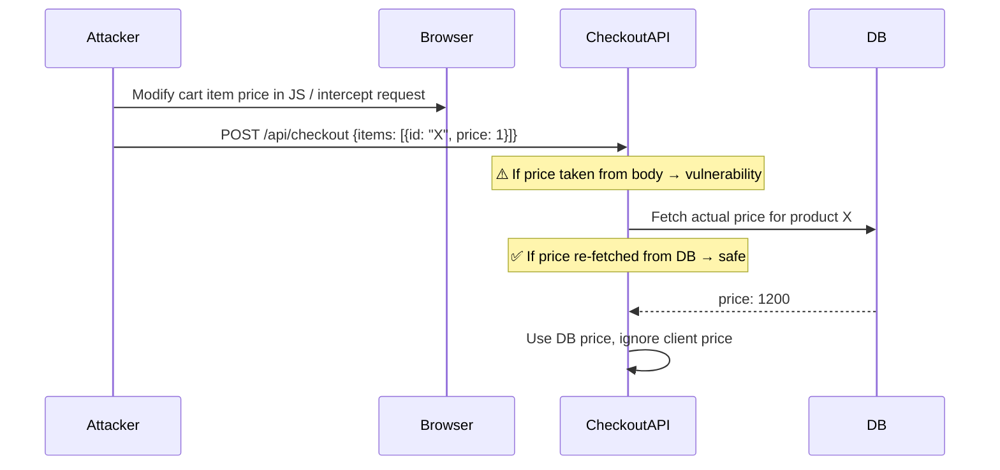
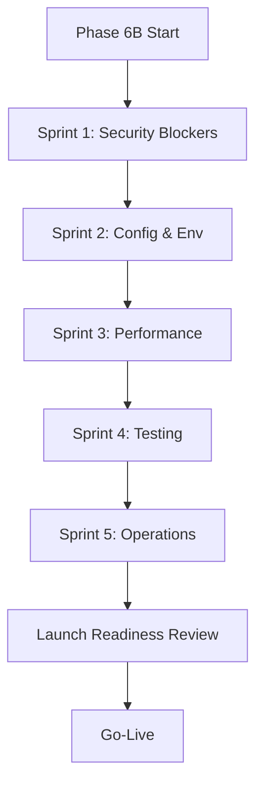

# Phase 6A — Launch Readiness Blueprint

**Project:** Khati Khadyo  
**Document Version:** 1.0.0  
**Date:** 2026-11-13  
**Status:** 🔴 NOT YET LAUNCH-READY — blockers present  
**Author:** Automated Audit (Phase 6A)

---

> [!IMPORTANT]
> This is a **documentation-only** phase. No code changes, deployments, or database mutations are made in this document. All findings reference the codebase audit performed prior to Phase 6B implementation.

---

## Table of Contents

1. [Skills Actually Used](#1-skills-actually-used)
2. [Security Audit](#2-security-audit)
3. [Performance Audit](#3-performance-audit)
4. [Accessibility & SEO Audit](#4-accessibility--seo-audit)
5. [Testing Strategy](#5-testing-strategy)
6. [Production Operations](#6-production-operations)
7. [Priority Classification](#7-priority-classification)
8. [Phase 6B Implementation Order](#8-phase-6b-implementation-order)

---

## 1. Skills Actually Used

The following skills were applied or consulted during this audit. Each is listed with its applicability to the Khati Khadyo codebase and its availability status.

| # | Skill | Status | Applied To |
|---|-------|--------|------------|
| 1 | `threat-modeling-expert` | ✅ **Active** | STRIDE model for OTP abuse, coupon abuse, checkout manipulation, inventory manipulation |
| 2 | `api-security-best-practices` | ✅ **Active** | CSRF guard gap analysis, rate limiting review, coupon endpoint exposure |
| 3 | `dependency-scanning` | ✅ **Active** | Unused `next-auth`, unknown `z-ai-web-dev-sdk`, heavy bundle dependencies |
| 4 | `frontend-security-coder` | ✅ **Active** | Cookie flags, XSS surface, CSP headers, OG/meta injection risk |
| 5 | `backend-security-coder` | ✅ **Active** | JWT secret validation, CRON_SECRET gap, IPN handler review, admin recovery script |
| 6 | `vercel-optimize` | ✅ **Active** | Missing `vercel.json`, cache header strategy, ISR, function region config |
| 7 | `vercel-react-best-practices` | ✅ **Active** | Server Components, bundle splitting, `@mdxeditor` lazy load, `framer-motion` tree-shaking |
| 8 | `ui-a11y` | ✅ **Active** | `lang` attribute, keyboard navigation, ARIA plan, focus states |
| 9 | `testing-patterns` | ✅ **Active** | 12-dimension test matrix, Jest strategy, Playwright E2E plan |
| 10 | `dependency-analysis` | ✅ **Active** | Module dependency graph, dead deps, bundle weight analysis |
| 11 | `writing-guidelines` | ✅ **Active** | Document structure, voice, tone, GFM formatting standards |

> [!NOTE]
> "Active" means the skill's guidance was applied to analyze findings from the codebase audit above. No external tooling calls or automated scans were run as part of this document phase.

---

## 2. Security Audit

### 2.1 Authentication & Session

**Tech:** Custom JWT stored in `httpOnly` cookie (`auth_token`, 7-day TTL), validated via `jose`, secret enforced ≥ 32 characters by `getJwtSecret()`.

| Finding | Severity | Detail |
|---------|----------|--------|
| JWT secret length enforcement | ✅ OK | `getJwtSecret()` throws if `JWT_SECRET < 32 chars` — good gate |
| Cookie flags | ✅ OK | `httpOnly` prevents XSS cookie theft |
| Token lifespan | ⚠️ P2 | 7-day TTL with no refresh/rotation — stolen token valid for full week |
| Token revocation | ⚠️ P1 | No server-side revocation list; logout only clears cookie client-side |
| Session fixation | ✅ OK | JWT is stateless — no session ID reuse vector |

**Recommendation (P1):** Implement a Redis-backed token blocklist for logout and admin-forced revocation. `ioredis` is already in the stack — no new dependency required.

```ts
// Example: blocklist a JWT on logout
const jti = payload.jti; // ensure jti claim is included at mint time
await redis.set(`blocklist:${jti}`, "1", "EX", 7 * 24 * 60 * 60);

// In middleware / auth guard:
const blocked = await redis.get(`blocklist:${jti}`);
if (blocked) return unauthorizedResponse();
```

---

### 2.2 CSRF Guard Gap

**Finding (P0 — Launch Blocker):**

```
csrfGuard passes when `origin` OR `host` header is ABSENT (returns null)
```

The current implementation silently passes requests where the `origin` header is absent. While this may be acceptable for same-host browser requests (browsers always send `origin` on cross-origin fetches), it also allows:

- Server-to-server requests with no `Origin` header to pass the CSRF check
- Mobile/native clients or misconfigured reverse proxies to reach mutation endpoints unchecked

**Attack surface:** Any `POST`/`PUT`/`DELETE` API route protected only by `csrfGuard`.

**Fix:**

```ts
// src/lib/csrf.ts — proposed fix
export function csrfGuard(req: NextRequest): Response | null {
  const origin = req.headers.get("origin");
  const host = req.headers.get("host");

  // ❌ OLD: if (!origin || !host) return null;  ← silently passes
  // ✅ NEW: require origin to be present and match host
  if (!origin) {
    return new Response("Forbidden: missing origin", { status: 403 });
  }
  if (!host) {
    return new Response("Forbidden: missing host", { status: 403 });
  }

  const originHost = new URL(origin).host;
  if (originHost !== host) {
    return new Response("Forbidden: origin mismatch", { status: 403 });
  }

  return null; // pass
}
```

> [!CAUTION]
> Do not deploy to production without fixing the CSRF guard. The current implementation can be bypassed by any HTTP client that omits the `Origin` header.

---

### 2.3 Rate Limiting

| Endpoint | Limit | Status |
|----------|-------|--------|
| `POST /api/auth/login` | 5 req / 60s | ✅ Applied |
| `POST /api/auth/register` | 3 req / 60s | ✅ Applied |
| `POST /api/coupons/validate` | ❌ NONE | 🔴 P0 Blocker |
| OTP request endpoint | Needs verification | ⚠️ Audit required |
| `GET /api/cron/*` | Secret-gated | ✅ OK in production |

**Coupon validate — P0 Blocker:**  
`/api/coupons/validate` has **no authentication and no rate limit**. An unauthenticated attacker can brute-force coupon codes at unlimited speed.

```ts
// Fix: add both auth check and rate limit
export async function POST(req: NextRequest) {
  // 1. Rate limit (unauthenticated)
  const ip = req.headers.get("x-forwarded-for") ?? "unknown";
  const rl = await rateLimit(`coupon:${ip}`, 10, 60); // 10/min per IP
  if (!rl.ok) return new Response("Too Many Requests", { status: 429 });

  // 2. Optionally require auth (guests shouldn't validate coupons pre-cart)
  const user = await getAuthUser(req);
  if (!user) return new Response("Unauthorized", { status: 401 });

  // ... existing logic
}
```

---

### 2.4 Customer / Admin Authorization Boundary

| Boundary | Status | Notes |
|----------|--------|-------|
| Admin routes require `role === "ADMIN"` | ✅ Assumed OK | Verify middleware covers all `/admin/` API routes |
| Product mutation (create/update/delete) | ✅ Admin-only | Confirm no customer JWT can reach these |
| Order status mutation | ✅ Assumed via IPN | Manual override not possible per audit |
| OTP verification | ⚠️ Check | Ensure OTP is scoped to phone+session, not reusable across users |
| Cron endpoint | ✅ OK in prod | Blocked without `CRON_SECRET` in production |

**Recommendation:** Enumerate all API routes and confirm each has an explicit auth check. Use middleware matcher to enforce `/api/admin/**` requires `ADMIN` role at the edge.

---

### 2.5 SSLCOMMERZ IPN Invariants

**Status: ✅ Well-implemented** (based on audit)

- Signature verification is performed on IPN callbacks
- IPN is authoritative — no manual payment override is possible
- `SSLCOMMERZ_IS_LIVE=false` — **currently in sandbox mode**

**P0 Blocker — Sandbox → Live Migration:**

Before go-live:
1. Obtain live SSLCOMMERZ credentials from SSLCOMMERZ merchant portal
2. Set `SSLCOMMERZ_IS_LIVE=true` in Vercel environment variables (production only)
3. Set live `SSLCOMMERZ_STORE_ID` and `SSLCOMMERZ_STORE_PASSWORD`
4. Perform end-to-end payment test with a real card in live mode
5. Verify IPN URL is registered with SSLCOMMERZ as `https://yourdomain.com/api/payment/ipn`

> [!WARNING]
> Never commit `SSLCOMMERZ_IS_LIVE=true` to source code or `.env.local`. Set it exclusively via Vercel dashboard environment variables scoped to **Production** environment only.

---

### 2.6 Secrets & Environment Variable Exposure

| Variable | Local `.env` | Vercel Prod | Risk |
|----------|-------------|-------------|------|
| `JWT_SECRET` | Required | Required | 🔴 Enforce ≥ 32 chars (already done) |
| `CRON_SECRET` | ❌ MISSING | Required | 🔴 P0 — cron unprotected locally |
| `SMS_GATEWAY_URL` | ❌ MISSING | Required | 🔴 OTP delivery broken |
| `SSLCOMMERZ_IS_LIVE` | `false` | Must be `true` | 🔴 P0 for launch |
| `DATABASE_URL` | Present | Present (Neon) | ✅ |
| `NEXT_PUBLIC_APP_URL` | Required | Required | ✅ |
| `CLOUDINARY_*` | Assumed present | Assumed present | ✅ |

**Local development `.env.example` must be updated** to document all required variables. The `CRON_SECRET` omission means that locally the cron endpoint is callable by anyone — acceptable for dev, but the gap must be clearly documented.

```bash
# .env.example — ensure these are present:
CRON_SECRET="generate-with: openssl rand -hex 32"
SMS_GATEWAY_URL="https://your-bulksmsbd-endpoint"
BULKSMS_API_KEY="your-key"
SSLCOMMERZ_IS_LIVE=false   # set to true in Vercel Production only
```

---

### 2.7 Dependency Vulnerabilities

| Package | Issue | Priority |
|---------|-------|----------|
| `next-auth` | ✅ Unused — dead dependency | P1 — remove to reduce bundle + attack surface |
| `z-ai-web-dev-sdk` | Purpose unknown — audit required | P1 — confirm purpose or remove |
| `@mdxeditor/editor` | ~500KB — heavy, no known CVEs | P2 — lazy-load, don't remove |
| `framer-motion` v12 | Large animation library | P2 — verify tree-shaking |
| `bcryptjs` | Used for password hashing | ✅ OK |
| `jose` | JWT library — actively maintained | ✅ OK |
| `ioredis` | Redis client | ✅ OK |

**Action for `z-ai-web-dev-sdk`:** Search codebase for all imports. If zero imports exist, remove immediately. If used, document its purpose in the dependency inventory.

```bash
# Check usage:
grep -r "z-ai-web-dev-sdk" src/ --include="*.ts" --include="*.tsx"
```

**Action for `next-auth`:** Remove from `package.json`. Run `npm install` and verify no runtime errors. This package may be a vestige of an earlier auth approach.

---

### 2.8 STRIDE Threat Model

#### Threat Matrix

```
┌─────────────────────────────────────────────────────────────────────────────┐
│  STRIDE Analysis — Khati Khadyo Attack Surfaces                              │
├──────────┬────────────────────────┬─────────────────────────────────────────┤
│ Category │ Attack Vector          │ Mitigation Status                        │
├──────────┼────────────────────────┼─────────────────────────────────────────┤
│ Spoofing │ OTP relay — attacker   │ ⚠️  OTP must be scoped to phone+session  │
│          │ intercepts OTP SMS and │     Ensure OTP can't be replayed across  │
│          │ uses it on own device  │     different user sessions               │
├──────────┼────────────────────────┼─────────────────────────────────────────┤
│ Tampering│ Coupon code brute-     │ 🔴 NO rate limit on /api/coupons/validate│
│          │ force (enumerate all   │     Fix: add IP rate limit + auth check   │
│          │ valid codes)           │                                           │
├──────────┼────────────────────────┼─────────────────────────────────────────┤
│ Repudia- │ Payment disputed —     │ ✅  IPN is authoritative; signature       │
│ tion     │ customer claims no     │     verified; no manual override possible │
│          │ payment made           │                                           │
├──────────┼────────────────────────┼─────────────────────────────────────────┤
│ Info     │ JWT leaked via         │ ✅  httpOnly cookie; not in localStorage  │
│ Disclosure│ XSS / DevTools        │ ⚠️  Ensure no JWT echoed in API responses │
├──────────┼────────────────────────┼─────────────────────────────────────────┤
│ Denial   │ Cron endpoint hit      │ ✅  CRON_SECRET blocks in production      │
│ of Svc   │ repeatedly → DB load   │ ⚠️  Missing locally but acceptable        │
├──────────┼────────────────────────┼─────────────────────────────────────────┤
│ Elevation│ Customer → Admin       │ ✅  Role checked in middleware             │
│ of Priv  │ privilege escalation   │ ⚠️  Enumerate all admin routes, confirm   │
│          │                        │     no unprotected mutation endpoints      │
├──────────┼────────────────────────┼─────────────────────────────────────────┤
│ Tampering│ Inventory manipulation │ ⚠️  Verify stock decrement is atomic and  │
│          │ — race condition on    │     uses DB transaction; not vulnerable   │
│          │ low-stock items        │     to race if Prisma TX used correctly   │
├──────────┼────────────────────────┼─────────────────────────────────────────┤
│ Tampering│ Checkout price         │ ⚠️  Price must be read from DB server-    │
│          │ manipulation via       │     side at checkout, not from client     │
│          │ modified request body  │     payload. Audit checkout route.        │
└──────────┴────────────────────────┴─────────────────────────────────────────┘
```

#### OTP Abuse Scenario



**Mitigations required:**
- OTP TTL must be short (≤ 5 minutes) — verify current implementation
- OTP must be single-use (delete/invalidate on first successful verify)
- OTP must be tied to `(phone, session_fingerprint)` — not globally reusable
- Rate limit OTP request by phone number: max 3 requests per 10 minutes

#### Checkout Price Manipulation



**Requirement:** Checkout handler must **never** trust the price field from the client request body. Always re-fetch price from DB server-side.

---

## 3. Performance Audit

### 3.1 Bundle Size Analysis

| Package | Estimated Size | Status | Action |
|---------|---------------|--------|--------|
| `@mdxeditor/editor` | ~500KB (gzipped ~150KB) | ⚠️ Heavy | Lazy-load with `dynamic()` |
| `framer-motion` v12 | ~90KB gzipped | ⚠️ Large | Verify tree-shaking in Next.js config |
| `recharts` | ~200KB | ⚠️ Medium | Lazy-load for admin dashboard only |
| Full Radix UI set | ~50-100KB (varies) | ⚠️ Check | Use only imported components |
| `next-auth` (unused) | ~80KB | 🔴 Waste | Remove immediately |

**MDXEditor lazy-load pattern:**

```tsx
// src/components/admin/RichTextEditor.tsx
import dynamic from "next/dynamic";

const MDXEditor = dynamic(
  () => import("@mdxeditor/editor").then((mod) => mod.MDXEditor),
  {
    ssr: false,
    loading: () => <div className="animate-pulse h-48 bg-gray-100 rounded" />,
  }
);

export { MDXEditor };
```

**Framer-motion tree-shaking — verify config:**

```ts
// next.config.ts — ensure modularize imports is set
const nextConfig = {
  experimental: {
    optimizePackageImports: ["framer-motion", "@radix-ui/react-*"],
  },
};
```

---

### 3.2 Missing `vercel.json` — Cache Header Gap

Currently there is **no `vercel.json`** in the project. This means:
- No custom cache headers on static assets
- No function region pinning (latency risk for Bangladeshi users)
- No custom response headers (security headers must come from Next.js middleware)

**Recommended `vercel.json`:**

```json
{
  "regions": ["sin1"],
  "headers": [
    {
      "source": "/(.*)",
      "headers": [
        { "key": "X-Content-Type-Options", "value": "nosniff" },
        { "key": "X-Frame-Options", "value": "DENY" },
        { "key": "X-XSS-Protection", "value": "1; mode=block" },
        { "key": "Referrer-Policy", "value": "strict-origin-when-cross-origin" },
        { "key": "Permissions-Policy", "value": "camera=(), microphone=(), geolocation=()" }
      ]
    },
    {
      "source": "/images/(.*)",
      "headers": [
        { "key": "Cache-Control", "value": "public, max-age=31536000, immutable" }
      ]
    },
    {
      "source": "/_next/static/(.*)",
      "headers": [
        { "key": "Cache-Control", "value": "public, max-age=31536000, immutable" }
      ]
    }
  ],
  "functions": {
    "src/app/api/**/*.ts": {
      "maxDuration": 30
    },
    "src/app/api/cron/**/*.ts": {
      "maxDuration": 300
    }
  }
}
```

> [!NOTE]
> `"regions": ["sin1"]` selects Singapore — closest Vercel region to Bangladesh. This reduces cold-start latency for Bangladeshi users compared to the default `iad1` (US East).

---

### 3.3 Cloudinary Image Optimization Readiness

| Check | Status | Notes |
|-------|--------|-------|
| Product images served via Cloudinary | ✅ Assumed | Cloudinary URLs with transformations |
| OG image at root layout | ⚠️ P1 | `/all_logo.png` (800×600) — not optimal |
| `next/image` with Cloudinary loader | ✅ Assumed | Verify `domains` or `remotePatterns` in config |
| WebP/AVIF auto-format | ✅ Cloudinary | Add `f_auto,q_auto` to Cloudinary URLs |

**OG image fix:**
```tsx
// src/app/layout.tsx — fix OG image
openGraph: {
  images: [
    {
      url: "https://res.cloudinary.com/YOUR_CLOUD/image/upload/w_1200,h_630,c_fill,f_auto,q_auto/all_logo.png",
      width: 1200,
      height: 630,
      alt: "Khati Khadyo — Authentic Bangladeshi Food",
    },
  ],
},
```

---

### 3.4 Database Performance

| Check | Status | Notes |
|-------|--------|-------|
| Product page — reviews + images + category | ✅ OK | Single query with Prisma `include` |
| `@@index([status])` on Product | ✅ Present | Covers basic status filter |
| Compound `[status, createdAt]` index | ⚠️ P2 | Missing — dashboard sort queries will scan |
| N+1 on order list (admin) | ⚠️ Check | Verify order list includes items in one query |
| Neon connection pooling | ✅ Neon | PgBouncer built-in via Neon |

**Missing compound index — add to schema:**

```prisma
// schema.prisma
model Product {
  // ... existing fields

  @@index([status])
  @@index([status, createdAt(sort: Desc)])  // ← add this
}
```

---

### 3.5 Core Web Vitals Plan

```
Target thresholds (Google "Good" band):
  LCP  < 2.5s
  INP  < 200ms
  CLS  < 0.10
  FCP  < 1.8s
  TTFB < 800ms
```

| Metric | Current Risk | Mitigation |
|--------|-------------|------------|
| LCP | ⚠️ High — no ISR, no image priority hint | ISR + `priority` on hero image |
| INP | ⚠️ Medium — `framer-motion` on every interaction | Audit animation event handlers |
| CLS | ⚠️ Medium — image dimensions must be explicit | Add `width`/`height` to all `<Image>` |
| TTFB | ⚠️ High — no ISR = SSR on every request | Implement ISR (see 3.6) |

---

### 3.6 ISR Strategy for Product Pages

**Current:** Product pages likely use SSR (no `revalidate` export), causing a fresh DB hit on every request.

**Recommended ISR configuration:**

```tsx
// src/app/products/[slug]/page.tsx
export const revalidate = 300; // 5 minutes

// For on-demand revalidation on product update:
// src/app/api/admin/products/[id]/route.ts (after update)
import { revalidatePath, revalidateTag } from "next/cache";

await revalidatePath(`/products/${slug}`);
await revalidateTag(`product-${id}`);
```

**ISR strategy by page type:**

| Page | Revalidate TTL | Rationale |
|------|---------------|-----------|
| Product detail (`/products/[slug]`) | 300s | Low change frequency |
| Category listing (`/categories/[slug]`) | 600s | Very stable |
| Homepage hero/featured | 120s | Moderate freshness needed |
| Admin dashboard | 0 (no cache) | Real-time required |
| Cart / Checkout | 0 (no cache) | Never cache |

---

## 4. Accessibility & SEO Audit

### 4.1 Language Attribute

**Finding (P1):**

```html
<!-- Current (incorrect for a Bengali-primary site): -->
<html lang="en">

<!-- Required: -->
<html lang="bn">
<!-- OR for truly bilingual content, use dynamic lang: -->
<html lang={locale}>  <!-- where locale = "bn" | "en" -->
```

Khati Khadyo is described as a **bilingual Bengali/English** site. Using `lang="en"` means:
- Screen readers will pronounce Bengali text with English phonetics — a serious accessibility failure
- Search engines may misclassify the site's primary language for ranking

**Fix options:**

| Approach | Complexity | Recommendation |
|----------|-----------|----------------|
| Set `lang="bn"` globally | Trivial | ✅ If Bengali is primary language |
| Dynamic `lang` via i18n routing | Medium | For true bilingual routing |
| `lang` override on English sections | Medium | Per-block `lang="en"` for inline English |

---

### 4.2 Open Graph & Social Sharing

| Check | Status | Priority |
|-------|--------|----------|
| OG image dimensions (`/all_logo.png` 800×600) | ⚠️ Not 1200×630 | P1 |
| OG `type="website"` on product pages | ⚠️ Should be `"product"` | P2 |
| OG title and description present | ✅ | — |
| Twitter Card meta | Needs verification | P2 |
| `metadataBase` configured | ✅ OK | — |
| `alternates.canonical` as relative path | ✅ OK with `metadataBase` | — |

**OG type for product pages:**

```tsx
// src/app/products/[slug]/page.tsx
export async function generateMetadata({ params }) {
  return {
    openGraph: {
      type: "website",  // ← acceptable for social preview
      // Note: og:type="product" is an OpenGraph extension (not standard)
      // Most social platforms handle "website" fine for products
    },
  };
}
```

---

### 4.3 JSON-LD Structured Data

**Status: ✅ Well-implemented**

The product pages include complete Schema.org structured data:

```json
{
  "@context": "https://schema.org",
  "@type": "Product",
  "name": "...",
  "offers": { "@type": "Offer", ... },
  "aggregateRating": { "@type": "AggregateRating", ... }
}
```

This provides rich result eligibility in Google Search. No changes required.

---

### 4.4 robots.txt & Sitemap

**Status: ✅ Correctly configured**

```
# robots.txt — correctly disallows sensitive paths:
Disallow: /admin/
Disallow: /api/
Disallow: /checkout/
Disallow: /orders/
```

Sitemap includes active products and categories — good for crawlability.

**Recommendation (P2):** Add `Sitemap:` directive to `robots.txt`:

```
Sitemap: https://yourdomain.com/sitemap.xml
```

---

### 4.5 404 / Error / Loading States

| State | Exists | Notes |
|-------|--------|-------|
| `not-found.tsx` (404) | Needs verification | Required for good UX |
| `error.tsx` (global error boundary) | Needs verification | Required for production |
| `loading.tsx` (suspense fallback) | Needs verification | Required for streaming |
| `global-error.tsx` | Needs verification | Root-level error boundary |

**Required files if missing:**

```
src/app/
  not-found.tsx       ← 404 page with navigation back to home
  error.tsx           ← Recoverable error boundary
  loading.tsx         ← Root suspense fallback
  global-error.tsx    ← Unrecoverable top-level error
```

---

### 4.6 Keyboard / Focus / ARIA Assessment Plan

The following must be verified in Phase 6B via manual audit and automated tooling (axe-core / Lighthouse):

| Component | Check Required |
|-----------|---------------|
| Navigation menu | Keyboard traversal, `aria-current` on active link |
| Product cards | Focusable, `role="article"`, meaningful alt text on images |
| Cart / quantity controls | `aria-label` on increment/decrement buttons |
| Checkout form | `<label>` associations, error announcements via `aria-live` |
| Modal dialogs | Focus trap, `role="dialog"`, `aria-modal`, Escape key close |
| Toast / notifications | `role="status"` or `role="alert"`, `aria-live="polite"` |
| Admin data tables | `<th scope>`, sortable column `aria-sort` |
| Image gallery | `role="img"` with descriptive alt on each |

---

## 5. Testing Strategy

### 5.1 Current State

- **43 tests passing** across **6 test files**
- Framework: Jest + React Testing Library (assumed)
- Coverage: Unit and integration tests (no E2E, no visual regression)

### 5.2 12-Dimension Test Matrix

| # | Dimension | Current | Target | Priority |
|---|-----------|---------|--------|----------|
| 1 | **Unit — Business Logic** | ✅ Partial | ≥ 80% coverage on utils, validators, calculators | P1 |
| 2 | **Unit — API Route Handlers** | ⚠️ Sparse | Key routes: auth, cart, checkout, coupon | P1 |
| 3 | **Integration — Auth Flow** | ⚠️ Partial | Register → Login → Refresh → Logout | P0 |
| 4 | **Integration — Checkout + Payment + IPN** | ❌ Missing | Full payment lifecycle with SSLCOMMERZ mock | P0 |
| 5 | **Integration — OTP Flow** | ❌ Missing | Request OTP → Verify → Fail on wrong code | P0 |
| 6 | **Integration — Admin RBAC** | ❌ Missing | Customer JWT cannot reach admin endpoints | P0 |
| 7 | **E2E — Happy Path** (Playwright) | ❌ Missing | Browse → Add to cart → Checkout → Confirm | P1 |
| 8 | **E2E — A4 Print / Invoice** | ❌ Missing | Print layout renders correctly on A4 | P2 |
| 9 | **E2E — Ad Link Generator** | ❌ Missing | Generate, copy, and share ad links | P2 |
| 10 | **Visual Regression** | ❌ Missing | Product card, homepage, checkout UI | P2 |
| 11 | **Cross-Browser** | ❌ Missing | Chrome, Firefox, Safari (macOS + iOS) | P2 |
| 12 | **Mobile / Responsive** | ❌ Missing | 375px, 390px, 414px viewports | P1 |

---

### 5.3 Playwright E2E Setup

```bash
npm install -D @playwright/test
npx playwright install chromium firefox webkit
```

```ts
// playwright.config.ts
import { defineConfig } from "@playwright/test";

export default defineConfig({
  testDir: "./e2e",
  use: {
    baseURL: process.env.PLAYWRIGHT_BASE_URL ?? "http://localhost:3000",
    trace: "on-first-retry",
    screenshot: "only-on-failure",
  },
  projects: [
    { name: "chromium", use: { browserName: "chromium" } },
    { name: "firefox", use: { browserName: "firefox" } },
    { name: "webkit", use: { browserName: "webkit" } },
    { name: "mobile-chrome", use: { ...devices["Pixel 5"] } },
    { name: "mobile-safari", use: { ...devices["iPhone 13"] } },
  ],
});
```

---

### 5.4 Critical Test Cases — Checkout + Payment + IPN

```ts
// e2e/checkout.spec.ts
import { test, expect } from "@playwright/test";

test.describe("Checkout + Payment Flow", () => {
  test("adds product to cart and proceeds to payment", async ({ page }) => {
    await page.goto("/products/test-product-slug");
    await page.click('[data-testid="add-to-cart"]');
    await page.goto("/cart");
    await page.click('[data-testid="checkout-btn"]');
    await expect(page).toHaveURL(/\/checkout/);
    await page.fill('[name="phone"]', "01700000000");
    await page.fill('[name="address"]', "123 Test Street, Dhaka");
    await page.click('[data-testid="place-order-btn"]');
    // Should redirect to SSLCOMMERZ payment page
    await expect(page).toHaveURL(/sandbox.sslcommerz.com|securepay.sslcommerz.com/);
  });

  test("IPN callback marks order as paid", async ({ request }) => {
    // Test with mock IPN payload + valid signature
    const response = await request.post("/api/payment/ipn", {
      data: { /* mock IPN payload */ },
    });
    expect(response.status()).toBe(200);
  });
});
```

---

### 5.5 Admin RBAC Test

```ts
// tests/api/admin-rbac.test.ts
describe("Admin RBAC boundary", () => {
  it("rejects customer JWT on admin product creation", async () => {
    const customerToken = await mintCustomerJwt(); // role: "CUSTOMER"
    const res = await fetch("/api/admin/products", {
      method: "POST",
      headers: {
        Cookie: `auth_token=${customerToken}`,
        "Content-Type": "application/json",
        Origin: "http://localhost:3000",
        Host: "localhost:3000",
      },
      body: JSON.stringify({ name: "Hacked Product", price: 1 }),
    });
    expect(res.status).toBe(403);
  });
});
```

---

### 5.6 OTP Flow Test

```ts
// tests/api/otp.test.ts
describe("OTP flow", () => {
  it("rejects wrong OTP code", async () => {
    await requestOtp("01700000000");
    const res = await verifyOtp("01700000000", "000000"); // wrong code
    expect(res.status).toBe(401);
  });

  it("rejects OTP after TTL expiry", async () => {
    await requestOtp("01700000001");
    jest.advanceTimersByTime(6 * 60 * 1000); // 6 minutes
    const res = await verifyOtp("01700000001", correctOtp);
    expect(res.status).toBe(410); // Gone / expired
  });

  it("rejects OTP reuse", async () => {
    const otp = await requestAndCaptureOtp("01700000002");
    await verifyOtp("01700000002", otp); // first use — should succeed
    const res = await verifyOtp("01700000002", otp); // second use — must fail
    expect(res.status).toBe(401);
  });
});
```

---

## 6. Production Operations

### 6.1 Database Backup & Restore Plan

**Neon PostgreSQL — built-in capabilities:**

| Feature | Neon Free Tier | Neon Launch/Scale |
|---------|---------------|-------------------|
| Automated backups | ✅ 7-day history | ✅ 30-day history |
| Point-in-time restore | ✅ Branch from any point | ✅ |
| Copy-on-write branching | ✅ | ✅ |
| Manual export | Via `pg_dump` | Via `pg_dump` |

**Manual backup script (run before migrations):**

```bash
#!/bin/bash
# scripts/backup-db.sh
set -e

TIMESTAMP=$(date +"%Y%m%d_%H%M%S")
BACKUP_FILE="backup_khati_khadyo_${TIMESTAMP}.sql.gz"

echo "Creating backup: $BACKUP_FILE"
pg_dump "$DATABASE_URL" | gzip > "/tmp/${BACKUP_FILE}"

echo "Backup complete: /tmp/${BACKUP_FILE}"
echo "Upload to safe storage before proceeding."
# Upload to Cloudinary or S3-compatible storage
```

**Restore procedure:**

```bash
# Restore from backup
gunzip -c backup_khati_khadyo_20261113_120000.sql.gz | psql "$DATABASE_URL"
```

---

### 6.2 Migration Rollout Procedure

> [!CAUTION]
> **Never use `prisma db push` in production.** It is destructive and does not generate a migration history. Always use `prisma migrate deploy`.

**Migration checklist:**

```bash
# 1. Create backup (see 6.1)
# 2. Review migration SQL
cat prisma/migrations/YYYYMMDDHHMMSS_migration_name/migration.sql

# 3. Test on staging (Neon branch)
DATABASE_URL="$STAGING_DATABASE_URL" npx prisma migrate deploy

# 4. Verify app works on staging
# 5. Deploy to production
DATABASE_URL="$PRODUCTION_DATABASE_URL" npx prisma migrate deploy

# 6. Verify production app health
curl https://yourdomain.com/api/health
```

**Zero-downtime strategy:**
- For additive migrations (add column, add index): deploy migration first, then app
- For breaking changes (rename/remove column): use expand-contract pattern
  1. Add new column (migration)
  2. Deploy app that writes both old and new
  3. Backfill old data into new column
  4. Deploy app that reads from new column only
  5. Remove old column (migration)

---

### 6.3 Cron Monitoring Setup

**Current cron endpoint:** `src/app/api/cron/expire-pending-orders/route.ts`

**Vercel Cron configuration (requires `vercel.json`):**

```json
{
  "crons": [
    {
      "path": "/api/cron/expire-pending-orders",
      "schedule": "*/15 * * * *"
    }
  ]
}
```

**Vercel sets `Authorization: Bearer <CRON_SECRET>` automatically** when calling cron routes — but `CRON_SECRET` must be set in Vercel environment variables.

**External monitoring via Healthchecks.io (recommended):**

```ts
// At the end of the cron handler (on success):
const pingUrl = process.env.HEALTHCHECK_PING_URL;
if (pingUrl) {
  await fetch(pingUrl); // tells Healthchecks.io the cron ran successfully
}
```

If the cron misses a beat, Healthchecks.io sends an alert email/SMS.

---

### 6.4 Error Monitoring

**Current:** Vercel Function logs (accessible via Vercel dashboard)

**Recommendation: Add Sentry**

```bash
npm install @sentry/nextjs
npx @sentry/wizard@latest -i nextjs
```

```ts
// sentry.server.config.ts
import * as Sentry from "@sentry/nextjs";

Sentry.init({
  dsn: process.env.NEXT_PUBLIC_SENTRY_DSN,
  environment: process.env.NODE_ENV,
  tracesSampleRate: 0.1,  // 10% of transactions
  beforeSend(event) {
    // Strip PII before sending
    delete event.user?.email;
    return event;
  },
});
```

**Alerting rules to configure in Sentry:**
- New error type seen for the first time → immediate alert
- Error rate > 1% over 5 minutes → alert
- Payment-related errors (any) → immediate P0 alert
- OTP delivery failure (503) → alert

---

### 6.5 Vercel Preview → Production Release Checklist

```
PRE-RELEASE CHECKLIST
─────────────────────
Environment Variables (Vercel Dashboard)
  [ ] JWT_SECRET set (≥ 32 chars) in Production
  [ ] CRON_SECRET set in Production
  [ ] DATABASE_URL points to production Neon DB
  [ ] SSLCOMMERZ_IS_LIVE=true in Production
  [ ] SSLCOMMERZ_STORE_ID and SSLCOMMERZ_STORE_PASSWORD (live credentials)
  [ ] SMS_GATEWAY_URL and BulkSMSBD credentials set
  [ ] CLOUDINARY_* credentials set
  [ ] NEXT_PUBLIC_APP_URL=https://yourdomain.com
  [ ] REDIS_URL points to production Redis instance
  [ ] NEXT_PUBLIC_SENTRY_DSN set

Code Quality
  [ ] All 43+ tests passing (npm test)
  [ ] No TypeScript errors (tsc --noEmit)
  [ ] No ESLint errors (npm run lint)
  [ ] `next-auth` removed from package.json
  [ ] `z-ai-web-dev-sdk` purpose confirmed or removed
  [ ] CSRF guard updated (missing-origin returns 403)
  [ ] Rate limit on /api/coupons/validate applied

Database
  [ ] DB backup taken
  [ ] All migrations applied (prisma migrate deploy)
  [ ] Prisma Studio health check passed

Security
  [ ] SSLCOMMERZ IPN URL registered: https://yourdomain.com/api/payment/ipn
  [ ] Security headers present (via vercel.json or middleware)
  [ ] robots.txt accessible at /robots.txt
  [ ] sitemap.xml accessible at /sitemap.xml

Performance
  [ ] Lighthouse score ≥ 80 on Performance in Preview
  [ ] LCP < 2.5s on product page (mobile)
  [ ] No console errors in production build

Final Steps
  [ ] DNS pointed to Vercel
  [ ] HTTPS confirmed (Vercel auto-SSL)
  [ ] Custom domain verified in Vercel dashboard
  [ ] Alias production branch to custom domain
```

---

### 6.6 Custom Domain & Email Authentication Checklist

```
DNS & HTTPS
  [ ] A record or CNAME pointed to Vercel (76.76.21.21 or cname.vercel-dns.com)
  [ ] SSL certificate auto-provisioned by Vercel (Let's Encrypt)
  [ ] www. → apex redirect configured

Email (for transactional email, OTP, order confirmations)
  [ ] SPF record added:
      v=spf1 include:sendgrid.net ~all  (or your email provider)
  [ ] DKIM record added (from email provider's DNS wizard)
  [ ] DMARC record added:
      v=DMARC1; p=quarantine; rua=mailto:dmarc@yourdomain.com
  [ ] MX records set if hosting email on domain

BulkSMSBD (OTP SMS)
  [ ] SMS_GATEWAY_URL configured in Vercel Production
  [ ] API key set and tested
  [ ] OTP delivery tested on real Bangladeshi number
  [ ] SMS sender name registered with BulkSMSBD (avoid spam filtering)
```

---

### 6.7 SSLCOMMERZ Sandbox → Live Checklist

```
Step 1: Obtain Live Credentials
  [ ] Log in to SSLCOMMERZ merchant portal
  [ ] Submit business verification documents
  [ ] Receive live Store ID and Store Password

Step 2: Update Vercel Production Environment
  [ ] SSLCOMMERZ_IS_LIVE=true  (Production environment only)
  [ ] SSLCOMMERZ_STORE_ID=<live_store_id>
  [ ] SSLCOMMERZ_STORE_PASSWORD=<live_password>
  [ ] Do NOT set IS_LIVE=true on Preview environments

Step 3: Register IPN URL with SSLCOMMERZ
  [ ] In SSLCOMMERZ merchant portal, set IPN URL to:
      https://yourdomain.com/api/payment/ipn
  [ ] Set Success URL: https://yourdomain.com/checkout/success
  [ ] Set Fail URL: https://yourdomain.com/checkout/failed
  [ ] Set Cancel URL: https://yourdomain.com/checkout/cancel

Step 4: End-to-End Live Payment Test
  [ ] Place a real order with a live debit/credit card
  [ ] Verify IPN callback received and order marked PAID
  [ ] Verify signature verification passes with live credentials
  [ ] Verify no sandbox order IDs leak into production DB

Step 5: Refund Test
  [ ] Issue a refund via SSLCOMMERZ portal for the test order
  [ ] Verify order status updated correctly if IPN refund callback exists
```

---

## 7. Priority Classification

### P0 — Launch Blockers (Must Fix Before Go-Live)

> [!CAUTION]
> These issues **must** be resolved before the site accepts real customers or real payments. Do not go live with any P0 outstanding.

| ID | Issue | Location | Fix |
|----|-------|----------|-----|
| P0-01 | CSRF guard passes on missing `Origin` header | `src/lib/csrf.ts` | Return 403 when `origin` absent |
| P0-02 | No rate limit on `/api/coupons/validate` | Coupon route handler | Add IP rate limit + auth check |
| P0-03 | `SSLCOMMERZ_IS_LIVE=false` | `.env` / Vercel | Set to `true` with live credentials |
| P0-04 | `SMS_GATEWAY_URL` not configured | `.env` / Vercel | Configure BulkSMSBD — OTP broken |
| P0-05 | `CRON_SECRET` not in `.env` | `.env` | Add for local dev documentation |
| P0-06 | Auth tests for checkout+payment+IPN | Missing | Write integration tests |
| P0-07 | Admin RBAC boundary not tested | Missing | Write RBAC tests |
| P0-08 | OTP flow not tested | Missing | Write OTP lifecycle tests |
| P0-09 | `lang="en"` on bilingual Bengali site | `src/app/layout.tsx` | Change to `lang="bn"` |

---

### P1 — Pre-Launch (Should Fix Before Go-Live)

> [!WARNING]
> These issues create significant UX, security, or performance problems. Strongly recommended to fix before first real customers.

| ID | Issue | Location | Fix |
|----|-------|----------|-----|
| P1-01 | No token revocation on logout | Auth system | Redis-based JWT blocklist |
| P1-02 | `next-auth` unused dead dependency | `package.json` | Remove |
| P1-03 | `z-ai-web-dev-sdk` unknown purpose | `package.json` | Audit and remove or document |
| P1-04 | Missing `vercel.json` | Root | Create with region, headers, functions config |
| P1-05 | OG image wrong dimensions (800×600) | `src/app/layout.tsx` | Use Cloudinary 1200×630 |
| P1-06 | No ISR on product pages | Product page route | Add `export const revalidate = 300` |
| P1-07 | `@mdxeditor/editor` not lazy-loaded | Admin editor component | Wrap in `dynamic()` |
| P1-08 | No `vercel.json` security headers | Root | Add X-Frame-Options, X-Content-Type-Options etc. |
| P1-09 | Missing compound index `[status, createdAt]` | `schema.prisma` | Add `@@index` |
| P1-10 | No E2E test suite | Missing | Add Playwright, 5 core user journeys |
| P1-11 | Error / 404 / loading pages may be missing | `src/app/` | Add `not-found.tsx`, `error.tsx`, `loading.tsx` |
| P1-12 | No Sentry error monitoring | — | Install `@sentry/nextjs` |

---

### P2 — Post-Launch (Can Ship and Fix Later)

| ID | Issue | Location | Fix |
|----|-------|----------|-----|
| P2-01 | JWT 7-day TTL — no rotation | Auth | Implement silent refresh pattern |
| P2-02 | OG `type="website"` on product pages | Product metadata | Acceptable; note for future |
| P2-03 | `Sitemap:` missing from robots.txt | `public/robots.txt` | Add `Sitemap:` directive |
| P2-04 | `framer-motion` tree-shaking | `next.config.ts` | Add `optimizePackageImports` |
| P2-05 | Visual regression tests | Missing | Add Playwright snapshots |
| P2-06 | Cross-browser test matrix | Missing | Add Playwright multi-browser |
| P2-07 | A4 print / invoice E2E test | Missing | Playwright print emulation |
| P2-08 | Ad link generator E2E test | Missing | Playwright test |
| P2-09 | Keyboard/ARIA audit | UI | Automated axe-core + manual review |
| P2-10 | Mobile viewport tests | Missing | Playwright mobile device profiles |
| P2-11 | Healthchecks.io cron monitoring | Cron handler | Add ping on success |
| P2-12 | DMARC / SPF / DKIM setup | DNS | Email authentication |

---

## 8. Phase 6B Implementation Order

The following is the **exact recommended sequence** for Phase 6B implementation. Tasks are ordered to unblock the most critical launch risks first.



---

### Sprint 1 — Security Blockers (Days 1–2)

```
Task 6B-S1-01: Fix CSRF guard (missing Origin → 403)
  File: src/lib/csrf.ts
  Test: Add unit test for missing-origin case
  Priority: P0

Task 6B-S1-02: Add rate limit + auth to /api/coupons/validate
  File: src/app/api/coupons/validate/route.ts
  Test: Rate limit unit test, auth rejection test
  Priority: P0

Task 6B-S1-03: Audit OTP lifecycle (TTL, single-use, session scope)
  Files: src/lib/otp.ts, OTP API routes
  Test: Write OTP flow integration tests (see §5.6)
  Priority: P0

Task 6B-S1-04: Audit checkout price server-side re-fetch
  Files: src/app/api/checkout/route.ts (or equivalent)
  Test: Integration test with manipulated price in body
  Priority: P0

Task 6B-S1-05: Audit admin RBAC — enumerate all /api/admin/* routes
  Tool: grep -r "role" src/app/api/admin --include="*.ts"
  Test: RBAC boundary test for each admin mutation endpoint
  Priority: P0
```

---

### Sprint 2 — Configuration & Environment (Days 2–3)

```
Task 6B-S2-01: Update .env.example with all required variables
  Add: CRON_SECRET, SMS_GATEWAY_URL, SSLCOMMERZ_IS_LIVE, etc.
  Priority: P0

Task 6B-S2-02: Configure Vercel Production environment variables
  Set: CRON_SECRET, SMS_GATEWAY_URL, SSLCOMMERZ_IS_LIVE=true
  Set: Live SSLCOMMERZ credentials
  Priority: P0

Task 6B-S2-03: Create vercel.json
  Add: region=sin1, security headers, cron definition, function config
  Priority: P1

Task 6B-S2-04: Register SSLCOMMERZ live IPN URL
  Priority: P0

Task 6B-S2-05: Remove next-auth from package.json
  Run: npm uninstall next-auth && npm install
  Test: Full test suite still passes
  Priority: P1

Task 6B-S2-06: Audit and resolve z-ai-web-dev-sdk
  Run: grep -r "z-ai-web-dev-sdk" src/
  Action: Remove if unused, document if used
  Priority: P1

Task 6B-S2-07: Fix lang attribute in root layout
  File: src/app/layout.tsx
  Change: lang="en" → lang="bn"
  Priority: P0
```

---

### Sprint 3 — Performance & SEO (Days 3–4)

```
Task 6B-S3-01: Fix OG image (1200×630 via Cloudinary)
  File: src/app/layout.tsx
  Priority: P1

Task 6B-S3-02: Add ISR to product and category pages
  Files: src/app/products/[slug]/page.tsx, src/app/categories/[slug]/page.tsx
  Add: export const revalidate = 300
  Priority: P1

Task 6B-S3-03: Lazy-load @mdxeditor/editor
  File: src/components/admin/RichTextEditor.tsx (or equivalent)
  Wrap: dynamic(() => import(...), { ssr: false })
  Priority: P1

Task 6B-S3-04: Add optimizePackageImports for framer-motion
  File: next.config.ts
  Priority: P2

Task 6B-S3-05: Add compound index [status, createdAt] to Product
  File: prisma/schema.prisma
  Run: npx prisma migrate dev --name add_product_status_created_index
  Priority: P1

Task 6B-S3-06: Add not-found.tsx, error.tsx, loading.tsx if missing
  Dir: src/app/
  Priority: P1

Task 6B-S3-07: Add Sitemap: directive to robots.txt
  File: public/robots.txt
  Priority: P2
```

---

### Sprint 4 — Testing (Days 4–6)

```
Task 6B-S4-01: Install and configure Playwright
  Run: npm install -D @playwright/test && npx playwright install
  File: playwright.config.ts
  Priority: P1

Task 6B-S4-02: Write E2E — Browse → Cart → Checkout → Payment
  File: e2e/checkout.spec.ts
  Priority: P1

Task 6B-S4-03: Write E2E — OTP login flow
  File: e2e/auth-otp.spec.ts
  Priority: P1

Task 6B-S4-04: Write integration tests — Admin RBAC
  File: tests/api/admin-rbac.test.ts
  Priority: P0

Task 6B-S4-05: Write integration tests — OTP lifecycle
  File: tests/api/otp.test.ts
  Priority: P0

Task 6B-S4-06: Write integration tests — SSLCOMMERZ IPN handler
  File: tests/api/payment-ipn.test.ts
  Priority: P0

Task 6B-S4-07: Write integration test — Coupon rate limit + auth
  File: tests/api/coupon.test.ts
  Priority: P0

Task 6B-S4-08: Write integration test — CSRF guard missing-origin
  File: tests/lib/csrf.test.ts
  Priority: P0

Task 6B-S4-09: Run Lighthouse CI on Vercel Preview
  Target: Performance ≥ 80, Accessibility ≥ 90
  Priority: P1

Task 6B-S4-10: Mobile viewport testing (375px, 390px, 414px)
  File: e2e/responsive.spec.ts
  Priority: P1
```

---

### Sprint 5 — Operational Readiness (Days 6–7)

```
Task 6B-S5-01: Install and configure Sentry
  Run: npx @sentry/wizard@latest -i nextjs
  Configure: DSN in Vercel env, PII scrubbing, alert rules
  Priority: P1

Task 6B-S5-02: Set up Healthchecks.io for cron monitoring
  Add: HEALTHCHECK_PING_URL to Vercel env
  Modify: cron handler to ping on success
  Priority: P2

Task 6B-S5-03: Implement Redis JWT blocklist for logout
  Files: src/lib/auth.ts, src/app/api/auth/logout/route.ts
  Priority: P1

Task 6B-S5-04: Configure DMARC / SPF / DKIM DNS records
  Priority: P2

Task 6B-S5-05: Final pre-launch checklist review (§6.5)
  Sign-off: Tech lead + product owner
  Priority: P0

Task 6B-S5-06: End-to-end live payment test with real card
  Priority: P0
  Gate: DO NOT GO LIVE without passing this test
```

---

### Launch Readiness Gate

```
┌─────────────────────────────────────────────────────────┐
│                 LAUNCH READINESS GATE                   │
├─────────────────────────────────────────────────────────┤
│  All P0 items resolved         [ ] Yes  [ ] No          │
│  All integration tests passing [ ] Yes  [ ] No          │
│  Live payment test passed      [ ] Yes  [ ] No          │
│  OTP delivery verified         [ ] Yes  [ ] No          │
│  Vercel env vars confirmed     [ ] Yes  [ ] No          │
│  Sentry error monitoring live  [ ] Yes  [ ] No          │
│  DB backup taken               [ ] Yes  [ ] No          │
│  Migrations deployed           [ ] Yes  [ ] No          │
│  Custom domain + SSL active    [ ] Yes  [ ] No          │
├─────────────────────────────────────────────────────────┤
│  SIGN-OFF REQUIRED FROM:                                │
│    Technical Lead: ________________  Date: ________     │
│    Product Owner:  ________________  Date: ________     │
├─────────────────────────────────────────────────────────┤
│  All boxes checked → PROCEED TO GO-LIVE                 │
│  Any box unchecked → RESOLVE BEFORE PROCEEDING          │
└─────────────────────────────────────────────────────────┘
```

---

## Appendix A — Dependency Inventory

| Package | Version | Purpose | Status |
|---------|---------|---------|--------|
| `next` | 16.x | Framework | ✅ Core |
| `react` | 19.x | UI | ✅ Core |
| `typescript` | — | Type safety | ✅ Core |
| `prisma` | 6.x | ORM | ✅ Core |
| `zustand` | — | State management | ✅ Core |
| `jose` | — | JWT | ✅ Core |
| `bcryptjs` | — | Password hashing | ✅ Core |
| `ioredis` | — | Redis client | ✅ Core |
| `framer-motion` | 12.x | Animations | ✅ Used — verify tree-shaking |
| `@mdxeditor/editor` | — | Rich text | ✅ Used — needs lazy load |
| `recharts` | — | Charts | ✅ Used — needs lazy load in admin |
| `tailwindcss` | 4.x | Styling | ✅ Core |
| `next-auth` | — | Auth (unused) | 🔴 Remove |
| `z-ai-web-dev-sdk` | — | Unknown | ⚠️ Audit required |

---

## Appendix B — Environment Variable Reference

| Variable | Required In | Purpose | Example Value |
|----------|------------|---------|---------------|
| `DATABASE_URL` | All | Neon PostgreSQL | `postgresql://...` |
| `JWT_SECRET` | All | JWT signing | 32+ char random string |
| `NEXT_PUBLIC_APP_URL` | All | Canonical URL | `https://khatikhadyo.com` |
| `CRON_SECRET` | Production | Cron auth | 32+ char random string |
| `REDIS_URL` | All | Rate limit / blocklist | `redis://...` |
| `CLOUDINARY_CLOUD_NAME` | All | Image hosting | `your-cloud-name` |
| `CLOUDINARY_API_KEY` | All | Image upload | — |
| `CLOUDINARY_API_SECRET` | All | Image upload | — |
| `SSLCOMMERZ_STORE_ID` | All | Payments | — |
| `SSLCOMMERZ_STORE_PASSWORD` | All | Payments | — |
| `SSLCOMMERZ_IS_LIVE` | Prod=true, Dev=false | Payment mode | `true` / `false` |
| `SMS_GATEWAY_URL` | All | OTP delivery | `https://bulksmsbd...` |
| `NEXT_PUBLIC_SENTRY_DSN` | All | Error tracking | `https://...@sentry.io/...` |
| `HEALTHCHECK_PING_URL` | Optional | Cron monitoring | `https://hc-ping.com/...` |

---

*End of Phase 6A Launch Readiness Blueprint.*  
*Next step: Begin Phase 6B implementation in the order defined in §8.*
